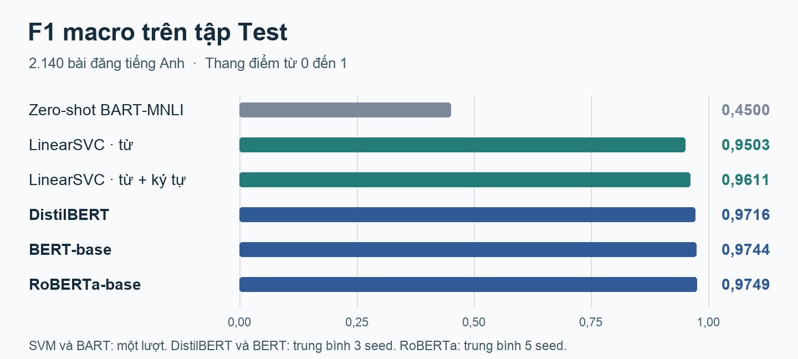

# Phát hiện tin giả về COVID-19
**Đồ án Xử lý ngôn ngữ tự nhiên · Nhóm 5 · HUFLIT**  
Giảng viên hướng dẫn **ThS. Trần Thị Thanh Thảo**

Nhóm so sánh cách phân loại bài đăng tiếng Anh thành hai nhãn `fake` và `real` trên bộ CONSTRAINT@AAAI2021. Có **6.420 bài Train**, **2.140 bài Validation** và **2.140 bài Test**.

## Bốn phần của đồ án

Mở **Xem bài** để đọc code và output ngay trên GitHub. Cột cuối dẫn tới số liệu của từng phần.

| Phần | Thành viên · MSSV | Notebook | Bảng kết quả |
|---|---|---|---|
| **01 · Baseline & zero-shot** | Vũ Hồng Huy · 24DH113458 | [Xem bài](members/huy_baseline_zeroshot/01_Baseline_ZeroShot.ipynb) | [Mở kết quả](members/huy_baseline_zeroshot/results/metrics.csv) |
| **02 · DistilBERT** | Lương Hoàng Bảo Quân · 24DH111520 | [Xem bài](members/quan_distilbert/02_DistilBERT.ipynb) | [Mở kết quả](reports/distilbert/metrics_3_seeds.csv) |
| **03 · BERT-base** | Đặng Thị Trúc Ly · 24DH112737 | [Xem bài](members/ly_bert/03_BERT.ipynb) | [Mở kết quả](members/ly_bert/results/metrics_3_seeds.csv) |
| **04 · RoBERTa-base** | Lê Nguyễn Ngọc Bình · 24DH113442 | [Xem bài](members/binh_roberta/04_RoBERTa.ipynb) | [Mở kết quả](members/binh_roberta/results/roberta_test_5seeds_summary.csv) |

## Kết quả trên 2.140 bài Test

Bổ sung n-gram ký tự nâng F1 macro của SVM từ **0,9503** lên **0,9611**. Trong ba mô hình fine-tune, F1 macro trung bình nằm trong khoảng **0,9716–0,9749**. BERT và RoBERTa chênh khoảng **0,0005** theo các lượt chạy đã lưu. Zero-shot chỉ phát hiện được khoảng **10,7%** số bài mang nhãn fake ở cách đặt giả thuyết đã thử.

[Bảng Accuracy, F1 macro và F1 weighted kèm cách tính](reports/README.md) · [Tải số liệu CSV](reports/so_sanh_test.csv)

## Mở và chạy lại

- **Xem phần DistilBERT của Quân** bằng chế độ `xem` để đọc ba seed trên CPU. [Mở trên Colab](https://colab.research.google.com/github/Doris1808/covid19-fake-news-nhom5/blob/main/members/quan_distilbert/02_DistilBERT.ipynb) · [Phiên Kaggle gốc đã lưu output](members/quan_distilbert/minh_chung/Phien_Kaggle_seed42.ipynb)
- **Chạy lại các thí nghiệm** theo hướng dẫn dữ liệu, GPU và checkpoint của từng thành viên. [Hướng dẫn chạy](docs/HUONG_DAN_CHAY.md)
- **Tải toàn bộ mã nguồn, dữ liệu và minh chứng** trong một file. [Tải ZIP từ GitHub](https://github.com/Doris1808/covid19-fake-news-nhom5/archive/refs/heads/main.zip)

[Ba tập CSV](data/raw) · [Bài báo và nguồn dữ liệu](docs/BAI_BAO_VA_MUC_TIEU.md) · [Bản lưu trước khi sắp xếp](archive/README.md)
